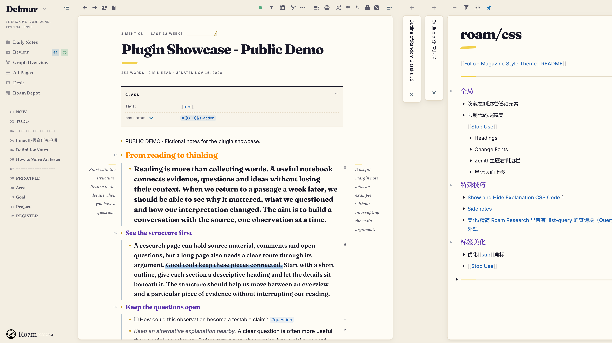
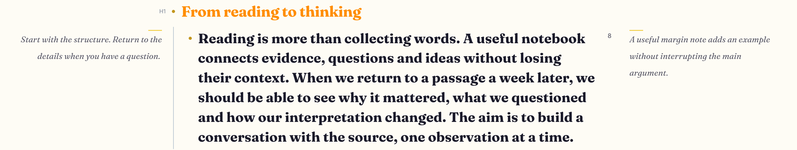
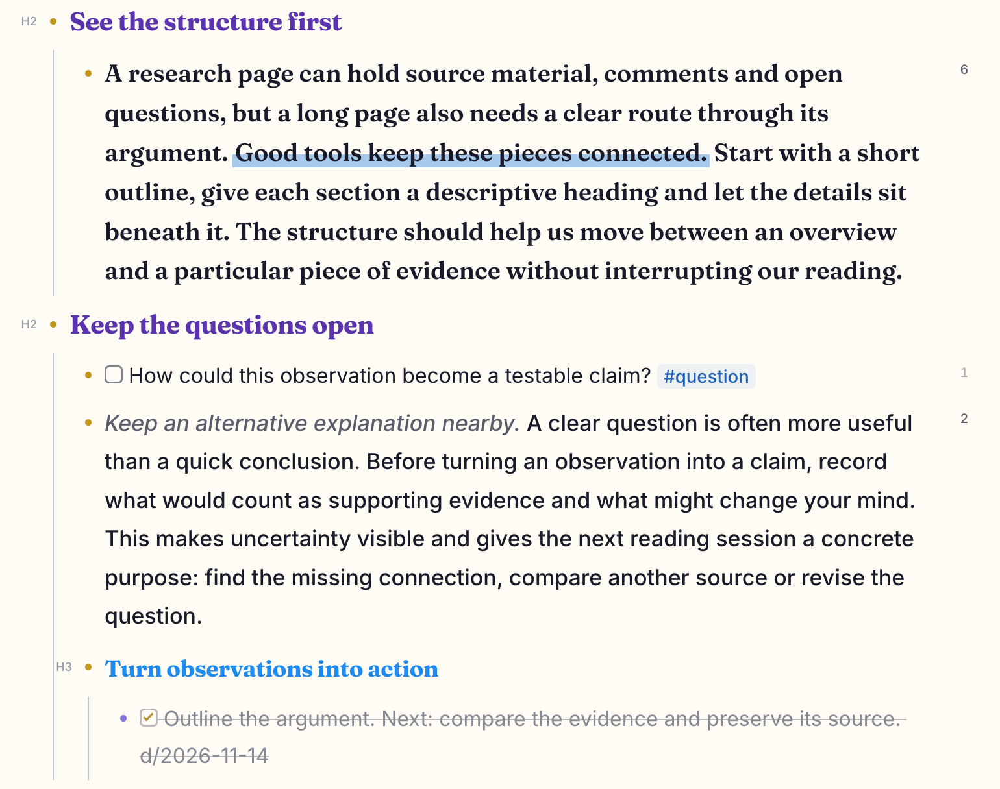
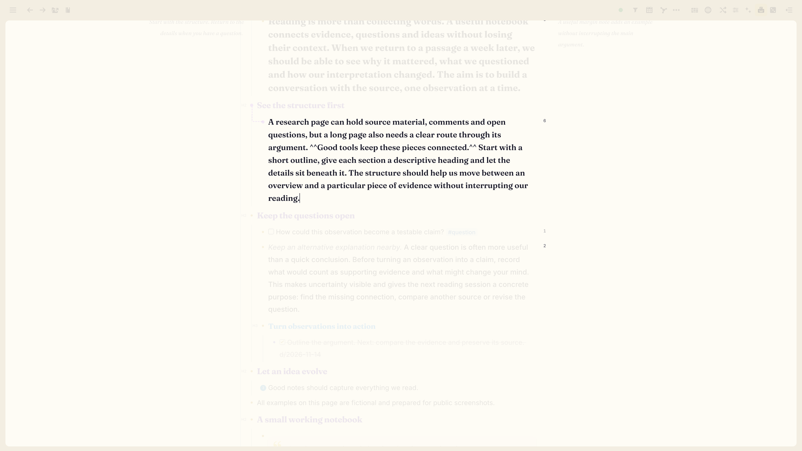
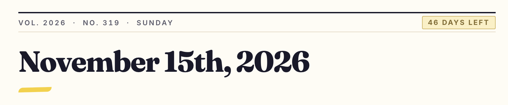
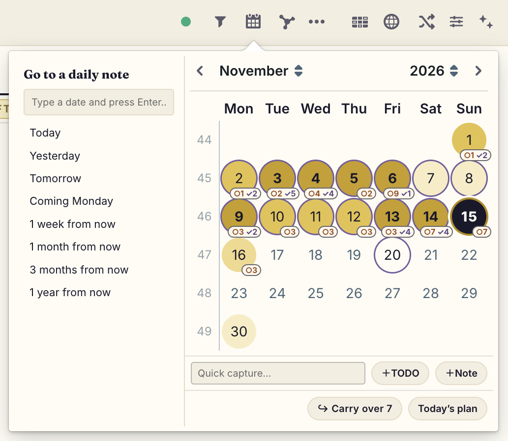

# Folio

**Magazine-style typography for Roam, with a collection of everyday tools you can use independently.**

I want my Roam to be a place I look forward to opening every day, somewhere I can spend time reading and writing. Built around that idea, Folio brings together warm paper colours, a clear heading hierarchy, generous margins and small everyday tools, giving notes a reading experience closer to a magazine or a printed page.

Beyond the main text, Folio also brings a consistent style to daily notes, sidebars, tags, properties and parts of the community plugin interface. It adapts Roam's AI entry points and The Desk so that different work areas feel visually connected.

The theme and tool components can be controlled separately. Turn on the theme if you enjoy magazine-style typography, or keep your preferred appearance and enable only the tools you need.

## Turn the right sidebar into a workspace alongside your page

The right sidebar is one of Folio's most important work areas.

When reading or writing, we often need several things open at once: a source text, a related note and an idea we are working through. Folio arranges right-sidebar content as horizontally browsable cards, opening them alongside the main page.

Each card keeps its own scroll area and native controls. Move between cards, expand, collapse or close one of them, and continue reading the main text.

Roam's native AI entry point also sits in the main top bar, while conversations stay in right-sidebar cards. History, topics and new-conversation controls follow the chat card, making it easy to read notes while asking questions and organising ideas.

## Give supporting details a place of their own

Margin notes are a feature I particularly care about.

When writing, some child blocks belong in the main text; others are examples, explanations or another line of thought that has just occurred to me. I want to decide where each one belongs, keeping the main argument flowing while leaving useful supporting material nearby.

Folio can place selected child blocks to the left or right of the main text:

- Choose **Aside: Left** or **Aside: Right** from a block bullet's context menu.
- Or add `#.aside-left` or `#.aside` to the child block.

Other child blocks keep their normal outline structure. If there is not enough room in the margin, the aside stays within the main text.

For example, place a key question on the left and an explanation or example on the right, while developing the main argument in the centre. Asides adjust to Roam's native page width and the space available beside the sidebars.

## Capture ideas while watching a video

An idea in a video is often worth writing down immediately. Folio's theatre mode brings the video and timestamped notes together on the main page, connecting watching, note-taking and revisiting.

Click **Timestamp** to add a note below the video and start editing. Every note has a timestamp that takes you back to the corresponding moment. Edit, save or delete the text directly. When you need the original block, use **Open** to view it in the right sidebar.

In smaller windows, the video's height is limited to leave room for notes. Larger windows retain margins on both sides, keeping the video and notes aligned. When revisiting an interview, lecture or course, you can follow your own notes straight to the moments worth watching again.

## Make frequently used ideas stand out

Some passages are referenced again and again, gradually becoming important connections between pages. Folio can adjust their visual weight according to the number of block references, displaying frequently used content in a more prominent font size.

The demonstration page contains passages with different numbers of real block references, showing how font size and emphasis change. This feature has its own switch and preserves the original reference counts and navigation.

## Keep everyday actions close at hand

Folio also includes a collection of independently enabled components for writing, navigation, reading and review:

**Writing and code:** typewriter mode and writing goals; code-block height limits, jump-to-start/end controls, copying, search, and replacement of the current match or all matches. Tools appear automatically on newly expanded code blocks, and search remembers its position in the current block.

**Daily notes and calendar:** magazine-style daily-note mastheads; date navigation, activity heatmaps, daily-note previews and quick capture; handling unfinished TODOs from yesterday, custom shortcuts and configurable daily-note templates.

**Reading and media:** image and caption styles, an expanded PDF reading view, and video theatre mode with timestamped notes.

**Tags and page information:** special tags and stamps, OR check/cross dropdowns, property cards and visual weight based on reference counts; a page data line shows the word count and estimated reading time, while the page pulse shows recent mentions.

**Interface and navigation:** visibility controls for top-bar icons and left-sidebar items, sidebar toggles, a page relationship graph entry point, scrollbar visibility, Workbench dropdown compatibility and right-sidebar cards.

**Tasks and review:** nine sorting options in The Desk, type filters, pinning multiple cards and choosing a headline; Random TODO 3 helps rediscover tasks, with options to exclude particular pages and tasks carrying future dates.

**Appearance:** fonts for body text, headings and asides, plus a two-line motto.

All **29 components** are organised into seven functional categories. Each can be switched on or off separately and carries an estimated resource-use rating. The top-bar settings panel can be dragged to a convenient position, and the page remains usable while it is open, so you can adjust your setup as you work.

Interface translations and documentation are available in English, Chinese, Italian, German, French and Spanish. See [Folio's GitHub page](https://github.com/DelmarHuang/roam-folio) for the complete component list, detailed features and instructions. The [full manual](https://github.com/DelmarHuang/roam-folio/blob/depot-submission-2026-11-15/README.md) is also available in the repository.

Two independent plugins work alongside Folio: [Reading Desk](https://github.com/DelmarHuang/roam-reading-desk) brings reading, annotations and thinking together; [Version Studio](https://github.com/DelmarHuang/roam-version-studio) helps compare note versions, trace changes in your thinking and rewrite with confidence.
